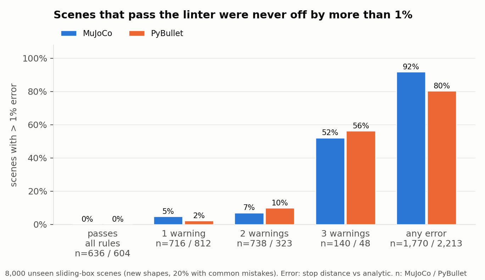
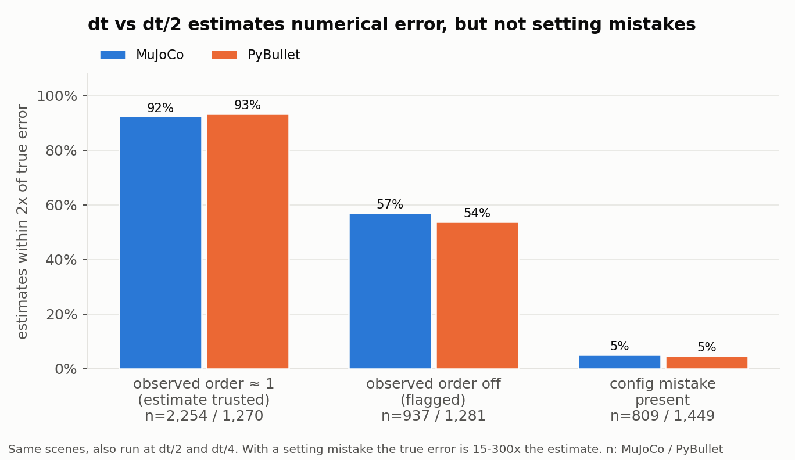

# simdiff-check

**A linter for physics-simulation settings, plus a ground-truth-free error estimate.**
It catches the MuJoCo and PyBullet settings that silently make contact and dynamics results wrong,
and tells you how much numerical error is left in a run, without needing an analytic answer.

Every rule comes from measurement, not folklore. The rules came out of
[SimDiff](#background), a study that ran about 180,000 simulations against analytic and
high-precision reference solutions. Each rule was then re-tested on 8,000 new random scenes it had never seen.



On those 8,000 new scenes, the **1,240 scenes that passed every rule were never off by more than 1% (worst 0.9%)**.
Every scene with more than 1% error was flagged (recall 100%).
One warning alone rarely mattered (2-5% of scenes went over 1%). Three warnings together pushed the error over 1% in more than half the scenes.

## Install

```bash
pip install "simdiff-check[all]"        # or [mujoco] / [pybullet]
```

## Use

### MuJoCo: point it at a model

```bash
simdiff-check mujoco robot.xml --event-time 0.4
```

It reads the **compiled** `MjModel`, so `<default>` inheritance, `include`, the `refsafe` clamp, the `override`
flag, `geom priority` and `solmix` are all resolved to the values the engine actually uses.

```
[ERROR] MJ002 A moving body has lower friction than what it touches (MuJoCo uses the larger value)
  where:    geom crate ↔ floor
  value:    this body's μ=0.5 but the contact uses μ=1 (the larger of the two)
  evidence: box μ=0.4 on a default floor (μ=1.0) → effective μ 1.00; 809 validation scenes with this
            mistake: median stop-distance error 55% (simdiff-check V2)
  fix:      lower the friction of the floor (and everything it touches) too, or use geom priority

[WARNING] MJ001 Contact timeconst below 10 x dt (contact too stiff)
  value:    effective timeconst 0.015 s = 3.8 x dt (need ≥ 10 x dt)
  ...
```

`--event-time` is how long the thing you care about lasts (a box sliding to a stop, one grasp contact).
Without it, the step-count rules are skipped.

### PyBullet: run your script under the recorder

PyBullet has no API to read back link damping, contactERP or URDF load flags. So `simdiff-check` records
the calls your script makes, then checks the live scene right before each `disconnect()`:

```bash
simdiff-check pybullet train_env.py --event-time 0.4
```

Or from Python:

```python
import pybullet as p
import simdiff_check.pybullet as sdc

sdc.install()                  # before any loadURDF / createMultiBody
...                            # build your scene as usual
print(sdc.audit(event_time=0.4).to_text())
```

URDF inertia is checked by re-reading the URDF and comparing it with what `getDynamicsInfo` reports.

### Estimate numerical error without ground truth

Run the same simulation at `dt`, `dt/2` and `dt/4`. The difference estimates the error at `dt`
(Richardson). The third run checks whether that estimate can be trusted.

```python
from simdiff_check import check_mujoco
sc = check_mujoco(model, duration=2.0, setup=start_pose, levels=3)   # examples/selfcheck_arm.py
print(sc.to_text())
# self-disagreement error estimate (dt=0.001, theoretical order 1): ±0.008565
#   observed order 0.98 → trustworthy
```

When the estimate can't be trusted, the report says why. If the value keeps running away as dt shrinks
(by more than 10% of the value), it is marked **DIVERGING** and shouldn't be reported at all. This is what
happens to peak contact force in impulse-based engines. Otherwise the spread across dt, dt/2 and dt/4 is
given as a rough error band.

**For contact metrics (peak force, impulse), use `usable`, not `reliable`.** The observed-order check
assumes smooth convergence. On 90 contact cases (3 engines, 9 approach speeds; see
[contact_gap](https://github.com/bluvtx09/contact_gap) finding 15) it wrongly said "trustworthy" 34 times,
sometimes with a 60% spread. `usable` (spread across dt..dt/4 at most 10% of the value) agreed with a
dt/8 reference in 90 of 90 cases, while needing half the compute.

For any engine, pass your own `run(dt) -> observable` to `simdiff_check.self_disagreement`.
From the CLI: `simdiff-check mujoco model.xml --selfcheck 2.0`.



When the observed order matched the theoretical one, **92-93% of estimates were within 2x of the true
error**, and 0.3% or fewer underestimated it by more than 2x. On a chaotic 2-link arm the estimate
matched the true error almost exactly (median ratio 1.00, rank correlation 0.999).

**The self-check cannot see setting mistakes.** A default floor friction or leftover damping changes
the model itself, not how accurately it is solved. There the true error was 15-300x the estimate. That's
why the tool pairs it with the linter: the linter catches wrong *settings*, and the self-check measures
*numerical* error.

### In CI

```yaml
- run: pip install "simdiff-check[mujoco]"
- run: simdiff-check mujoco models/robot.xml --event-time 0.3 --strict
```

Exit code 1 on any error (with `--strict`, on any warning). `--json` gives machine-readable output.
`--lang ko` prints Korean. A ready-to-copy workflow is in [`examples/ci/`](examples/ci/simdiff-check.yml).

## Rules

`simdiff-check rules` prints the evidence and the fix for each rule.

| ID | Engine | Severity | Rule |
|---|---|---|---|
| PB001 | PyBullet | error | link damping is not zero (default 0.04) |
| PB002 | PyBullet | error | URDF inertia ignored (no `URDF_USE_INERTIA_FROM_FILE`) |
| PB003 | PyBullet | error | both bodies have friction < 1 (PyBullet multiplies: 0.5 x 0.5 = 0.25) |
| PB004 | PyBullet | warning | time step > 5 ms |
| PB005 | PyBullet | warning | contactERP > 0.6 |
| PB006 | PyBullet | warning | tipping margin τ > 0.9 |
| MJ001 | MuJoCo | warning | contact timeconst < 10 x dt |
| MJ002 | MuJoCo | error | moving body's friction lower than what it touches (MuJoCo takes the max) |
| MJ003 | MuJoCo | warning | tipping margin τ > 0.6 (MuJoCo tips boxes that rigid theory keeps upright) |
| MJ004 | MuJoCo | warning | contact timeconst > 0.2 x event duration |
| EV001 | both | warning | event shorter than 300 steps |
| EV002 | both | error | event shorter than 100 steps |
| INFO01 | both | info | first-order integrator |

τ = μ · half-height / half-width. For a box sliding on its face, rigid-body Coulomb theory says it tips only when τ ≥ 1.

## Validation

All numbers above are reproducible from [`validation/`](validation/):

| Script | Question | Result |
|---|---|---|
| `v1_rules_on_simdiff_data.py` | Does the linter implement the rules that fuzzing validated? Applied to 19,200 fuzzing runs and 61,440 Sobol runs from SimDiff | all 19,200 fuzzing runs pass; Sobol runs that pass: 0 over 1% (worst 0.91% / 0.51%) |
| `v2_end_to_end.py` | Out of sample: 8,000 new random scenes with new shapes and common mistakes mixed in, run through the real input path (MJCF string, PyBullet recorder) | passing scenes: 0 over 1%; recall 100%; every planted mistake caught |
| `v3_selfcheck.py` | Does dt vs dt/2 estimate the error, and does the observed-order check tell when it doesn't? | see figure above; tolerance 0.5 was fixed before looking at the data |

```bash
python validation/v1_rules_on_simdiff_data.py   # needs the SimDiff results folder (SIMDIFF_ROOT)
python validation/v2_end_to_end.py 4000 4000    # ~6 min on 2 cores
python validation/v3_selfcheck.py
python validation/figures.py
```

## Limits

- The observed-order check (`reliable`) is validated only for smoothly converging quantities: a sliding
  distance and joint trajectories. For contact peaks, use the spread check (`usable`).
- The thresholds come from a **pendulum, a 2-link arm and a box sliding to a stop**. They have not been
  validated for impacts (restitution), multi-point contact (grasping) or rolling objects.
  A pass means "none of the known failure patterns", not "correct".
- The linter is conservative: about half of the flagged scenes were still within 1%.
- The tipping check covers free bodies with a single box collision geom only.
- The PyBullet recorder only sees calls made after `install()`, and only via `pybullet` module functions
  (`from pybullet import loadURDF` done before `install()` bypasses it).
- MuJoCo 3.14.0 and PyBullet (Jan 2025 build). Engine defaults can change between versions.

## Background

The rules come from SimDiff, a reproducibility audit of MuJoCo and PyBullet. It combined analytic
reference solutions, Sobol sensitivity analysis, three rounds of fuzzing to find where rules break and then
repairing them, and a comparison of cross-engine and self-disagreement as error signals.
The preprint is in preparation, and section numbers in the rule evidence refer to it.

## License

MIT
